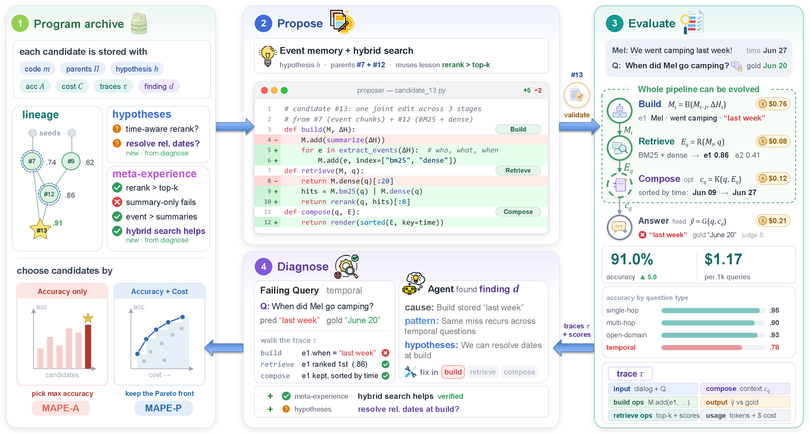

<h1 align="center">Discovering Effective Agent Memory Designs through Program Evolution</h1>

<p align="center">
  
  
  
  
</p>

<p align="center">
  <a href="#install">Install</a> ·
  <a href="#case-study-experiments">Case study</a> ·
  <a href="#evolutionary-search">Search</a> ·
  <a href="#baseline-evaluation">Baselines</a> ·
  <a href="#interface">Interface</a> ·
  <a href="#citation">Citation</a>
</p>

MAPE evolves agent memory systems as whole programs. A memory system is a
Python class with three stages, **build** (turn conversation history into a
memory), **retrieve** (select evidence for a query) and **compose** (organize the
evidence into the context the answering model sees). An LLM proposer rewrites
these programs, benchmark evaluation scores each candidate on accuracy and
serving cost, and a diagnosis agent reads the execution traces to explain what
went wrong, which guides the next proposal.

Two design patterns recur across the discovered systems, and both transfer
to human-designed ones:

- **Raw-conversation retention.** The memory retains raw conversations as
  retrievable evidence alongside its extracted memories, so details omitted
  from extraction still reach the answering model.
- **Query-Routed Scaffolding (RQS).** The compose stage routes each query to
  an intent-specific scaffold that combines targeted extraction,
  deterministic computation and deliberation before answering. Transplanted
  into five human-designed memory systems, it improves accuracy in every
  case.

<p align="center"></p>

This repository contains:

- **MAPE-A<sub>LME</sub> and its case study** ([`programs/mape_a/`](programs/mape_a/README.md),
  `experiments/`): the program evolved on LongMemEval that the paper
  analyzes, with its LoCoMo input adapter, and the experiments run on it:
  the raw-round and RQS ablations, the transplantation of RQS into five
  human-designed systems, and cross-benchmark transfer.
- **The evolution loop** (`evolution/`): proposer, diagnosis agent,
  candidate archive, accuracy-only and accuracy–cost search, and the
  prompts.
- **Interface, baselines and evaluation** (`core/`, `baselines/`,
  `benchmarks/`): the `MemoClass` lifecycle contract, full context, RAG and
  five human-designed memory systems (Mem0, A-Mem, LightMem, SimpleMem, Zep)
  behind it, and LoCoMo and LongMemEval evaluation with an LLM judge and
  per-stage cost accounting.

## Install

Python 3.12 and [uv](https://docs.astral.sh/uv/); run everything from the repository root.

```bash
uv sync --group dev
uv run python scripts/fetch_data.py      # LoCoMo and LongMemEval-S, checksum-verified
cp .env.example .env                     # fill in the keys you need (see below)
uv run pytest -q                         # offline checks, no model calls
```

What else you need depends on what you run:

| To run | You also need |
|---|---|
| Offline tests | Nothing beyond the commands above. |
| Any evaluation | `OPENAI_API_KEY` in `.env`. The judge (`gpt-5-mini`) and the embedder (`text-embedding-3-small`) always use the OpenAI API, and so does the default backbone (`gpt-4.1-mini`). |
| Case-study experiments | Linux with Singularity (Apptainer) for the evaluation container. The shipped configs use Qwen3-30B-A3B-Instruct-2507 as the backbone, served with vLLM at `http://127.0.0.1:8000/v1`. In bf16 it needs about 61 GB of GPU memory: two 48 GB GPUs or one 80 GB GPU. See [`scripts/vllm/`](scripts/vllm/README.md). |
| Evolutionary search | Singularity (Apptainer), the [Claude Code](https://docs.anthropic.com/en/docs/claude-code) CLI at `~/.local/bin/claude` (where the native installer puts it), and `ANTHROPIC_API_KEY` in `.env`. The proposer and the diagnosis agent reach Claude through the API only. The backbone is `gpt-4.1-mini`, so search needs no GPU. |
| Baselines | Each baseline has its own uv environment (`uv sync --project baselines/<name>`). Zep, LightMem and SimpleMem run local embedders or rerankers and are much faster on a GPU. |

## Case-study experiments

Full held-out runs and the paper's ablation and transplantation experiments
run in Singularity containers (build the images as in
[Evolutionary search](#evolutionary-search)):

```bash
uv run python -m evolution.heldout --config configs/evaluation/mape_a_longmemeval.yaml
uv run python scripts/prepare_experiments.py          # writes every arm to workspace/paper/
uv run python -m evolution.heldout --config workspace/paper/longmemeval_noraw/config.yaml
```

The no-RQS and transplantation arms replay a full run's retrieval, so run
that first and build its replay table with `scripts/build_replay.py`. No
results or traces are bundled. [docs/reproduction.md](docs/reproduction.md)
lists every arm and what it needs.

## Evolutionary search

Build the two container images, then start a search from one of the shipped configs:

```bash
mkdir -p .cache/images
singularity build .cache/images/eval-base.sif containers/eval-base.def
singularity build .cache/images/proposer-base.sif containers/proposer-base.def
uv run python -m evolution.orchestrator --config configs/evolution/locomo_accuracy.yaml
```

`configs/evolution/` holds the paper's four settings (LoCoMo or LongMemEval,
accuracy-only or accuracy–cost). Each run writes to `workspace/<run_name>/`:
every candidate's code and evaluation under `harnesses/`, the diagnosis
reports under `diagnostics/`, and the lineage and Pareto frontier in
`history.json` and `frontier.json`.
`uv run python scripts/search_history.py tree` (or `pareto`, `best`, `diff`)
summarizes a run.

## Baseline evaluation

The baselines (A-Mem, LightMem, Mem0, SimpleMem, Zep, RAG, ICL and a
no-memory control) are evaluated with the same answer model, judge and
cost accounting as MAPE. Each one runs in its own uv environment and is
configured by one YAML file, [`baselines/config.example.yaml`](baselines/config.example.yaml).
For example, to evaluate Mem0 on the LoCoMo held-out split:

```bash
uv sync --project baselines/mem0
cp baselines/config.example.yaml my_mem0.yaml   # harness: mem0, dataset: locomo
sed -i 's/^split: search/split: test/' my_mem0.yaml
uv run --project baselines/mem0 python -m baselines.eval_harness --config my_mem0.yaml
```

```text
[locomo] raw_score=... cost=$.../1k queries failed=False -> baselines/mem0/runs/<run_id>
```

Set `harness` and `dataset` (`locomo` or `longmemeval_s`) in the YAML to pick
another baseline or benchmark, and `size` to evaluate on a subset.
`arm: faithful` keeps each method's own published models, while
`arm: unified` swaps in the models under `unified_models` for a like-for-like
comparison. `--describe mem0` prints a baseline's defaults. Each run is saved
under `baselines/<name>/runs/` with its config, metrics and traces.

## Interface

A memory program is a directory whose `memo.py` subclasses `MemoClass`:

```python
from core.memo_class import MemoClass

class MyMemory(MemoClass):
    async def build_memory_from_data(self, recorder):        # recorder.init: the history
        ...

    async def retrieve_memory_for_query(self, recorder):     # recorder.init: history + query
        return {"passages": [...]}

    async def compose_memory_context(self, recorder, retrieved):   # optional
        return "\n".join(retrieved["passages"])
```

Make model calls through `core.llm.Agent` and `core.llm.Embedding` without
naming a model, so they use the run's backbone and are costed. Then:

```bash
uv run python scripts/run_method.py --harness path/to/my_memory --benchmark longmemeval --n 20
```

See `core/memo_class.py` for the full contract and `baselines/rag/memo.py`
for a short example.

## Repository layout

<details>
<summary>Directory map</summary>

```text
evolution/      search loop, proposer, diagnosis agent, prompts
core/           memory interface, evaluation, model calls, cost accounting, tracing
benchmarks/     LoCoMo and LongMemEval loaders, splits, QA and judge prompts
baselines/      full context, RAG, five memory systems, and the no-memory seed
programs/mape_a/ the released MAPE-A_LME program and its LoCoMo adapter
experiments/    ablation, transplantation and transfer wrappers
configs/        evolution and evaluation configurations
scripts/        data download, in-process evaluation, experiment preparation, search history
containers/     evaluation and proposer container definitions
tests/          offline checks: provenance, config, data isolation, cost accounting
docs/           reproduction guide and third-party provenance
```

</details>

## Citation

```bibtex
@article{mape2026,
  title   = {Discovering Effective Agent Memory Designs through Program Evolution},
  author  = {Ding, Xinheng and Cheshmi, Seyyed Saeid and Zhang, Ziyang and Chen, Tairan
             and Xie, Wenya and Hou, Yu and Zhang, Rui and Liu, Zirui},
  year    = {2026},
}
```

## License

Project-owned code is released under the Apache License 2.0 (`LICENSE`). The
bundled upstream implementations under `baselines/*/src/` keep their own
licenses (MIT or Apache-2.0); `NOTICE` and [docs/third_party.md](docs/third_party.md)
list them. Benchmark data are downloaded separately and remain under the terms
of their original releases.
